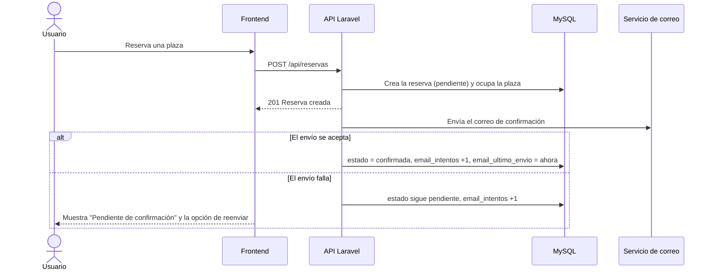

# Correo de confirmación de la reserva

Estado: **diseño. No está implementado**. La base de datos ya tiene los campos necesarios y falta el envío.

## 1. Objetivo

Cuando una persona reserva una plaza, recibe un correo que confirma la reserva y le da la información para acudir. El correo **no equivale a registrar la asistencia**: solo confirma que tiene plaza.

## 2. Qué existe hoy

| Elemento | Estado |
|---|---|
| `reservas.estado` con valores `pendiente`, `confirmada` y `cancelada` | Existe. Hoy toda reserva nueva queda en `pendiente` y no pasa a `confirmada` |
| `reservas.email_intentos` (entero, no negativo) | Existe, sin usar |
| `reservas.email_ultimo_envio` (fecha y hora, opcional) | Existe, sin usar |
| `MAIL_MAILER=log` en `backend/.env.example` | Los correos se escribirían en el registro, sin enviarse |
| Mailable, plantilla y servicio de correo en Docker | No existen |

## 3. Funcionamiento propuesto

1. La persona reserva (`POST /api/reservas`). La reserva se crea en estado `pendiente` y la plaza queda ocupada.
2. Tras guardar la reserva, el servidor envía el correo.
3. Si el envío se acepta: la reserva pasa a `confirmada`, `email_intentos` aumenta en 1 y `email_ultimo_envio` guarda la hora.
4. Si el envío falla: la reserva sigue en `pendiente`, `email_intentos` aumenta en 1 y la aplicación muestra el estado real ("Pendiente de confirmación"). La reserva **no se pierde ni se duplica**.
5. La persona puede pedir el reenvío (ver el apartado 5).

El envío debe ir en una **cola** (`QUEUE_CONNECTION=database` ya está configurado), para que un fallo del servicio de correo no retrase ni rompa la respuesta de la reserva.

## 4. Contenido del correo

| Campo | Origen |
|---|---|
| Asunto | "Reserva confirmada: *título de la charla*" |
| Nombre de la persona | `usuarios.nombre` |
| Título de la charla | `charlas.titulo` |
| Fecha y horario | `charlas.inicio` y `charlas.fin` (hora de España) |
| Ubicación | `ubicaciones.nombre` y municipio |
| Ponente | `ponentes.nombre` |
| Referencia de la reserva | Identificador de la reserva (por ejemplo `SBT-000123`) |
| Aviso | Mensaje de que el correo confirma la plaza, no la asistencia, y de que la reserva se gestiona en "Mis reservas" |

El correo no incluye `qr_secret` ni ningún dato de acceso secreto.

## 5. Reenvío controlado

Ruta prevista: `POST /api/reservas/{id}/reenviar-correo` (solo el propietario de la reserva).

Reglas propuestas, a acordar en el equipo:

- Solo si la reserva está en `pendiente` o `confirmada` (no si está cancelada).
- Máximo 3 intentos en total (`email_intentos`).
- Al menos 60 segundos desde `email_ultimo_envio`.
- El reenvío usa la misma reserva: **nunca crea una segunda inscripción**.
- Si se supera el límite, responde `429` o `409` con un mensaje claro.

## 6. Entorno de pruebas

Se propone añadir **Mailpit** al `docker-compose.yml`: un buzón de laboratorio que recibe los correos sin enviarlos fuera.

| Variable | Valor |
|---|---|
| `MAIL_MAILER` | `smtp` |
| `MAIL_HOST` | `mailpit` |
| `MAIL_PORT` | `1025` |
| Interfaz web de Mailpit | http://localhost:8025 |

## 7. Pruebas previstas

| Caso | Resultado esperado |
|---|---|
| Reserva válida con el servicio de correo activo | La reserva queda `confirmada` y el correo aparece en Mailpit con los datos correctos |
| Reserva con el servicio de correo caído | La reserva queda `pendiente`, la aplicación lo muestra y no hay error 500 |
| Reenvío tras recuperar el servicio | La reserva pasa a `confirmada` sin crear otra reserva |
| Reenvío antes de 60 segundos o tras 3 intentos | Se rechaza con un mensaje claro |
| Reenvío de una reserva ajena o cancelada | `404` o `409` |

## 8. Pendiente

Ver las tareas en [Pendientes](Pendientes.md): servicio Mailpit, Mailable y plantilla, cola, cambio de estado, endpoint de reenvío, mensaje en el frontend y pruebas.
