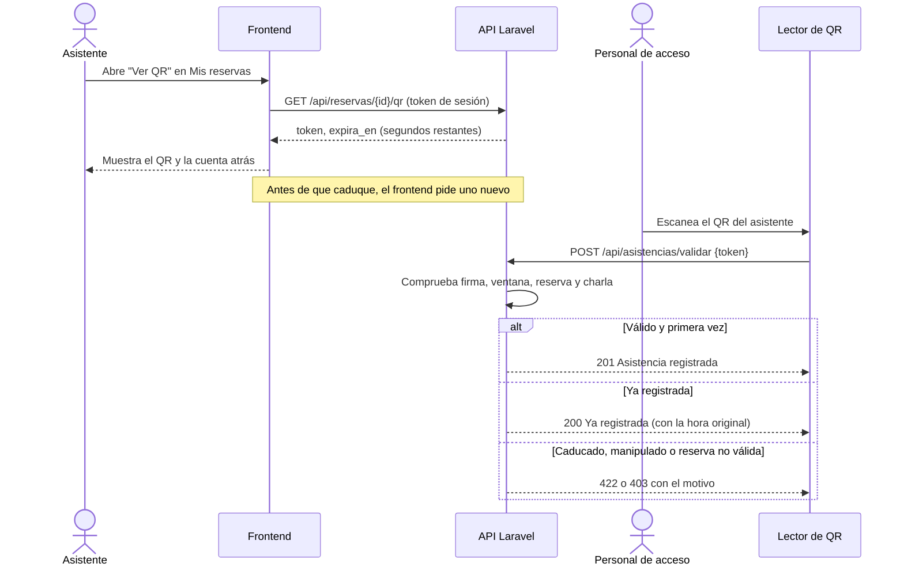

# QR temporal y control de asistencia

Estado: **diseño. No está implementado**. Hoy la pantalla "Mis reservas" tiene el botón "Ver QR" deshabilitado como maqueta, y la base de datos ya tiene los campos necesarios.

## 1. Objetivo

Registrar la asistencia a una charla con un código QR que **cambia cada 30 segundos** y cuya validez comprueba el servidor. Un temporizador en pantalla no es suficiente: el código debe caducar de verdad en el backend.

## 2. Qué existe hoy

| Elemento | Estado |
|---|---|
| `reservas.qr_secret` (64 caracteres, único) | Se genera al reservar (`Str::random(64)`) y nunca se envía al cliente |
| `asistencias.reserva_id` (único) | Una sola asistencia por reserva |
| `asistencias.validado_por` | Usuario que valida la asistencia |
| `asistencias.qr_token` (único, opcional) | Guardaría el token usado |
| `asistencias.validada_en` | Fecha y hora de la validación |
| Endpoints de QR y de validación, y librería de QR | No existen |

## 2.1 Qué representa el QR

El QR es la **acreditación de una reserva concreta**, no de una persona en general. Contiene un token temporal derivado del `qr_secret` de esa reserva. Quien lo muestra es el asistente desde su sesión; lo escanea el personal de acceso.

## 3. Diseño del token

El token se calcula en el servidor con un HMAC que depende de la reserva y de la ventana de 30 segundos:

```
ventana = floor(hora_del_servidor_en_segundos / 30)
firma   = HMAC-SHA256(clave = qr_secret, mensaje = reserva_id + ":" + ventana)
token   = reserva_id + "." + ventana + "." + firma
```

- El `qr_secret` no sale nunca del servidor. El cliente solo recibe el token ya calculado.
- El reloj de referencia es **el del servidor**. El navegador solo muestra una cuenta atrás con los segundos restantes que le indica el servidor.
- Como el token incluye la ventana, cambia solo cada 30 segundos sin guardar nada en la base de datos.

## 4. Flujo



## 5. Endpoints previstos

| Ruta | Quién | Qué hace |
|---|---|---|
| `GET /api/reservas/{id}/qr` | Propietario de la reserva | Devuelve el token actual, los segundos restantes de la ventana y el estado. Rechaza reservas canceladas, de charlas canceladas o ajenas |
| `POST /api/asistencias/validar` | Validador, organizador o admin | Recibe el token, lo valida y registra la asistencia |
| `POST /api/asistencias/manual` | Organizador o admin | Alternativa para quien no pueda mostrar el QR: registra la asistencia por referencia de reserva (ver el apartado 8) |

## 6. Validación en el servidor

Al recibir un token, el servidor comprueba por orden:

1. El formato es correcto (tres partes) y la reserva existe.
2. La firma coincide con la calculada con el `qr_secret` de esa reserva (comparación con `hash_equals`). Si no, el token está **manipulado**.
3. La ventana del token es la actual o **la inmediatamente anterior**. Cualquier otra está **caducada**.
4. La reserva está `confirmada` (no `pendiente` ni `cancelada`) y la charla no está cancelada.
5. La charla está en su horario de acceso. Propuesta: desde 30 minutos antes del inicio hasta el fin de la charla (a acordar con la organización).
6. No existe ya una asistencia para esa reserva.

**Tolerancia en el límite de la ventana:** si el escaneo llega justo al cambiar de ventana, se acepta la ventana anterior. La tolerancia está acotada a **una ventana (30 s más)**, de modo que el código nunca vale más de 60 segundos como máximo y no se convierte en una credencial indefinida.

## 7. Repeticiones y duplicados

- `uq_asistencias_reserva_id` impide registrar dos asistencias de la misma reserva aunque haya dos escaneos simultáneos.
- Si la persona ya está registrada, el servidor responde con un resultado comprensible ("Asistencia ya registrada a las HH:MM") **sin duplicar nada**.
- El registro se hace dentro de una transacción. Se guarda el token usado en `asistencias.qr_token` (único) para que el mismo token no se pueda reutilizar.

## 8. Cuando no se puede usar el QR

Si la persona no tiene batería, cámara o conexión, el personal autorizado puede registrar la asistencia **por referencia de reserva** (o por correo y charla) desde el área de gestión. Debe quedar constancia de quién la registró (`validado_por`).

## 9. Interfaz

- **Asistente:** pantalla de acreditación con el QR, cuenta atrás y estado. El QR se renueva solo antes de caducar.
- Si se pierde la conexión, la interfaz lo indica y **no muestra como válido un código vencido ni transmite una confirmación falsa**.
- **Personal de acceso:** pantalla de escaneo con un resultado claro por caso: válido, ya registrado, caducado, manipulado o reserva no válida.
- La cámara requiere HTTPS en un dispositivo distinto del ordenador de desarrollo (ver [Pendientes](Pendientes.md)).

## 10. Límites del diseño

- El QR rotativo reduce el tiempo en que un código se puede reutilizar, pero **no demuestra por sí solo la presencia física** de la persona: alguien podría enviar una captura a otra durante esos 30–60 segundos.
- Mitigación: el personal de acceso comprueba visualmente al asistente y se registra quién valida cada asistencia.

## 11. Pruebas previstas

| Caso | Resultado esperado |
|---|---|
| Validación correcta con un código vigente | `201` y asistencia guardada |
| Código de hace más de 60 segundos | Rechazado por caducado |
| Código con la firma alterada | Rechazado por manipulado |
| El mismo código o la misma reserva por segunda vez | `200` "ya registrada", sin duplicar |
| Reserva cancelada o charla cancelada | Rechazado |
| Escaneo justo en el cambio de ventana | Aceptado dentro de la tolerancia |
| Sin conexión en la pantalla del asistente | La interfaz avisa y no muestra el código como válido |

## 12. Pendiente

Ver las tareas en [Pendientes](Pendientes.md): endpoints de QR y de validación, rol de validador, librería de QR en el frontend, pantallas de acreditación y de escaneo, y pruebas.
