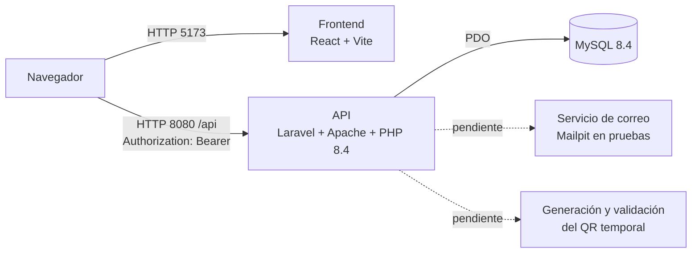
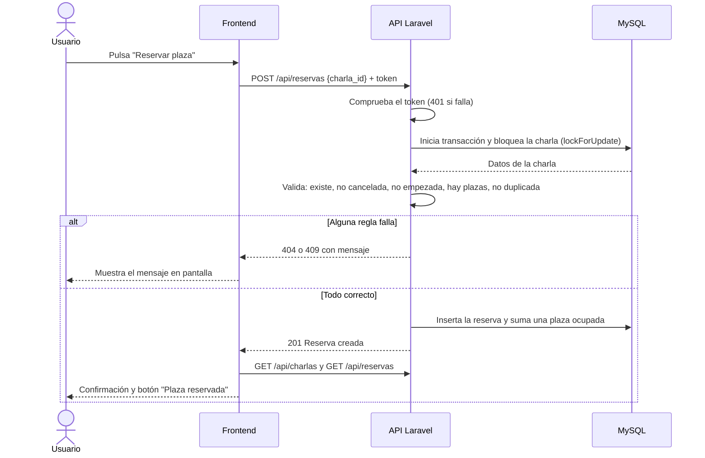

# Arquitectura de SABITECH WEB

## 1. Visión general

SABITECH WEB sigue una arquitectura de tres capas desacopladas: una aplicación de una sola página (SPA) en React, una API REST en Laravel y una base de datos MySQL. Las tres se ejecutan en contenedores con Docker Compose.



Las líneas discontinuas son componentes diseñados pero aún no implementados (ver [Correo de confirmación](Correo_Confirmacion.md) y [QR temporal](QR_Temporal.md)).

## 2. Componentes

| Componente | Tecnología | Responsabilidad | Puerto |
|---|---|---|---|
| `frontend` | Node 24, React 19, Vite 8 | Interfaz, navegación entre pantallas, validaciones de ayuda al usuario y llamadas a la API | 5173 |
| `web` | PHP 8.4, Apache, Laravel 13 | API REST: autenticación, permisos, reglas de reserva y acceso a datos | 8080 |
| `db` | MySQL 8.4 | Almacén de datos con claves foráneas, índices y restricciones | interno |

Los puertos solo se publican en `127.0.0.1`. La base de datos no se publica: solo es accesible desde la red interna de Docker.

## 3. Reparto de responsabilidades

- **Frontend:** muestra el estado y guía al usuario. Sus validaciones son de usabilidad; **la decisión final sobre aforo, permisos y validez de una reserva la toma siempre el backend**.
- **Backend:** valida los datos, autentica por token, comprueba permisos en el servidor y garantiza la coherencia de las reservas.
- **Base de datos:** protege la integridad con restricciones propias (claves foráneas, claves únicas, `CHECK`), de modo que una regla importante no depende solo del código.

## 4. Estructura del código

```
frontend/src/
  api/          Llamadas a la API (fetch) y clase ApiError
  components/   Navbar, Footer, formularios, modal de confirmación y tarjetas
  hooks/        Lógica reutilizable (charlas reservadas)
  models/       Clases de dominio (Charla, User)
  utils/        Utilidades de sesión
  views/        Pantallas: home, charlas, reservas, auth y perfil

backend/
  app/Http/Controllers/   UsuarioController, CharlaController, ReservaController, AsistenciaController
  app/Http/Middleware/    ComprobarToken (alias "token")
  database/migrations/    Esquema de la base de datos
  database/seeders/       Datos de prueba
  routes/api.php          Rutas de la API
```

## 5. Flujo de una petición

1. El navegador envía la petición a `/api/...` con la cabecera `Authorization: Bearer <token>`.
2. Apache entrega la petición a Laravel, que la enruta según `routes/api.php`.
3. El middleware `ComprobarToken` calcula el hash SHA-256 del token, busca al usuario y, si la ruta exige rol, lo comprueba. El usuario queda disponible para el controlador.
4. El controlador valida los datos y accede a MySQL con el constructor de consultas (`DB::table`, con parámetros).
5. La respuesta se devuelve en JSON con el código HTTP adecuado (200, 201, 401, 403, 404, 409 o 422).

## 6. Reserva de una plaza



El bloqueo de la fila de la charla dentro de la transacción impide que dos personas ocupen a la vez la última plaza. Además, la base de datos tiene una clave única (`uq_reservas_usuario_charla_activa`) que impide dos reservas activas de la misma persona para la misma charla aunque falle una comprobación del código.

## 7. Seguridad

- Contraseñas guardadas con hash (`Hash::make`).
- Token de sesión aleatorio de 60 caracteres, guardado en la base de datos solo como hash SHA-256. Se invalida al cerrar sesión.
- El usuario se obtiene del token, nunca de un identificador enviado por el cliente. Una persona solo puede ver y cancelar sus propias reservas.
- Permisos por rol comprobados en el servidor (ver [Permisos](Permisos.md)).
- Consultas con parámetros, sin concatenar datos del usuario en el SQL.
- Variables sensibles en ficheros `.env` que no se versionan; el repositorio solo incluye `.env.example` sin contraseñas reales.
- Los puertos de los contenedores solo escuchan en `127.0.0.1`.

## 8. Decisiones de diseño

| Decisión | Motivo |
|---|---|
| API separada del frontend | Permite desarrollar y probar cada parte por separado y dejar el servidor como única fuente de verdad |
| React con Vite | Componentes reutilizables y recarga en caliente durante el desarrollo |
| Laravel | Framework PHP con enrutado, middleware, migraciones y seeders que aceleran el desarrollo del servidor |
| MySQL con restricciones | La integridad de usuarios, charlas, reservas y asistencias se garantiza en la base de datos |
| Docker Compose | Entorno reproducible: cualquier miembro del equipo arranca lo mismo con los mismos pasos |
| Token propio en cabecera | Sencillo de explicar y suficiente para el alcance; no requiere sesiones de servidor |

## 9. Entornos

Hoy existe un único entorno, el de **desarrollo** (Docker Compose con recarga en caliente). Un entorno de **demostración** con compilación de producción del frontend, `APP_DEBUG=false` y HTTPS está pendiente (ver [Pendientes](Pendientes.md)).

## 10. Cómo ejecutarlo

Las instrucciones de instalación, los usuarios de prueba y los comandos habituales están en el [README](../../README.md). El detalle del entorno está en [Despliegue](Despliegue.md).

## 11. Documentos relacionados

- [Modelo de datos](Modelo_Datos.md)
- [Frontend](Frontend.md)
- [Backend](Backend.md)
- [Despliegue](Despliegue.md)
- [Recorridos de usuario](Recorridos_Usuario.md)
