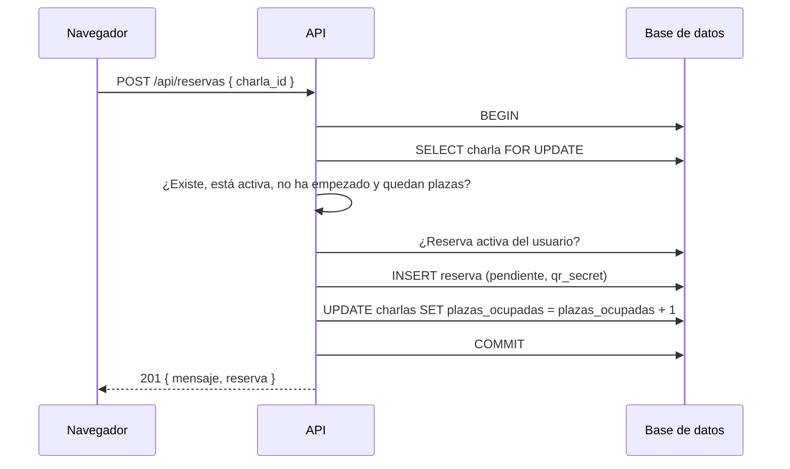

# Backend

El backend es una API REST hecha con Laravel 13 y PHP 8.4. Usa MySQL 8.4 y autenticación por token propio. No se usa Sanctum ni sesiones de Laravel: el token se guarda hasheado en `usuarios.api_token` y se envía en la cabecera `Authorization`.

## 1. Estructura

```text
backend/
├── app/Http/Controllers/   Charla, Reserva, Usuario y Asistencia
├── app/Http/Middleware/    ComprobarToken
├── bootstrap/app.php       Alias del middleware y errores JSON
├── database/migrations/    Esquema de la base de datos
├── database/seeders/       Datos de prueba
├── routes/api.php          Definición de endpoints
└── .env.example            Variables de entorno de ejemplo
```

## 2. Rutas

| Método | Ruta | Token | Rol | Acción |
|---|---|---|---|---|
| GET | `/api/charlas` | No | — | Listar todas las charlas |
| POST | `/api/register` | No | — | Crear una cuenta de asistente |
| POST | `/api/login` | No | — | Iniciar sesión y obtener token |
| GET | `/api/usuario` | Sí | Cualquiera | Datos del usuario autenticado |
| PATCH | `/api/usuario/foto-perfil` | Sí | Cualquiera | Actualizar la URL de la foto |
| POST | `/api/logout` | Sí | Cualquiera | Borrar el token |
| GET | `/api/reservas` | Sí | Cualquiera | Reservas activas del usuario |
| POST | `/api/reservas` | Sí | Cualquiera | Crear una reserva |
| PATCH | `/api/reservas/{id}/cancelar` | Sí | Cualquiera | Cancelar una reserva propia |
| GET | `/api/usuarios` | Sí | admin, organizador | Listar usuarios |
| GET | `/api/asistencias` | Sí | admin, organizador | Listar asistencias |
| POST | `/api/charlas` | Sí | admin | Crear una charla |

No existe un `GET /api/charlas/{id}`: el detalle se obtiene del listado completo. Es suficiente para el número de charlas del prototipo, pero en producción conviene un endpoint de detalle.

## 3. Autenticación

1. `POST /api/login` valida el correo y la contraseña con `Hash::check`.
2. Si son correctos, genera `Str::random(60)`.
3. Guarda `hash('sha256', $token)` en `usuarios.api_token`.
4. Devuelve el token en claro **solo en esa respuesta**.
5. El cliente lo envía como `Authorization: Bearer <token>`.
6. `ComprobarToken` busca el usuario por el hash del token.
7. Si la ruta exige roles, compara el rol en minúsculas y devuelve `403` si no coincide.
8. El usuario autenticado se guarda en `$request->attributes->get('usuario')`.
9. `POST /api/logout` pone `api_token` a `null`.

### Códigos de autenticación

| Código | Cuándo |
|---|---|
| 401 | No se envía token, el token no existe o la sesión ha caducado |
| 403 | El token es válido pero el rol no tiene permiso |

## 4. Controladores

### 4.1. `CharlaController`

- `index`: une `charlas`, `ponentes` y `ubicaciones`, ordena por `inicio` y devuelve todos los campos que necesita el frontend.
- `crearCharla`: valida ponente, ubicación, título, descripción, foto, fechas y aforo. Comprueba que el ponente y la ubicación existan, pone `plazas_ocupadas = 0` y `cancelada = false`.

### 4.2. `UsuarioController`

- `crearUsuario`: valida nombre, email único, teléfono, fecha de nacimiento (16 años mínimo), contraseña de 8 caracteres y foto opcional. Asigna siempre el rol `asistente` desde el servidor.
- `login`: comprueba credenciales y genera el token.
- `getUsuario`: devuelve los datos del usuario autenticado.
- `getUsuarios`: listado para administración y organización, sin contraseñas.
- `actualizarFotoPerfil`: actualiza la URL de la foto del usuario autenticado.
- `logout`: invalida el token.

### 4.3. `ReservaController`

- `listarMisReservas`: devuelve las reservas no canceladas del usuario, con datos de la charla, ponente y ubicación, ordenadas por fecha.
- `crearReserva`: crea la reserva dentro de una transacción.
- `cancelarReserva`: comprueba que la reserva sea del usuario, bloquea charla y reserva, impide cancelar si ya empezó y libera la plaza.

### 4.4. `AsistenciaController`

- `index`: une asistencias, reservas, usuarios y charlas para que organización pueda consultar quién ha validado su entrada.

## 5. Creación de una reserva



Puntos importantes:

- `lockForUpdate` evita que dos peticiones reserven la última plaza a la vez.
- El usuario se obtiene del token, nunca de un `usuario_id` enviado por el cliente.
- La reserva nace en estado `pendiente`.
- `qr_secret` se genera con `Str::random(64)` para el futuro QR.
- Si algo falla, la transacción se revierte y no se descuadra el aforo.

> La reserva queda guardada y la interfaz muestra una confirmación, pero el correo de confirmación y el QR todavía no se envían. Por eso el estado técnico es `pendiente`.

## 6. Cancelación

1. Se busca la reserva por `id` y `usuario_id`; si no existe, `404`.
2. Se bloquean la charla y la reserva.
3. Si ya está cancelada, `409`.
4. Si la charla ya empezó, `409`.
5. Se actualiza el estado a `cancelada`.
6. Se decrementa `plazas_ocupadas` solo si es mayor que 0.

## 7. Validaciones y errores

| Situación | Código | Mensaje |
|---|---|---|
| Datos inválidos | 422 | Errores por campo de Laravel |
| Token ausente o inválido | 401 | `Token no enviado` / `Token no válido` |
| Rol insuficiente | 403 | `No tienes permiso para esta acción` |
| Charla inexistente | 404 | `La charla no existe` |
| Reserva inexistente o ajena | 404 | `La reserva no existe` |
| Charla cancelada | 409 | `La charla está cancelada` |
| Charla empezada | 409 | `La charla ya ha empezado` |
| Sin plazas | 409 | `No quedan plazas libres` |
| Reserva duplicada | 409 | `Ya tienes una reserva para esta charla` |
| Reserva ya cancelada | 409 | `La reserva ya está cancelada` |

Laravel devuelve los errores de validación en `errors`. El frontend los transforma con `ApiError.erroresPorCampo`.

## 8. Ejemplos de uso

### Listar charlas

```bash
curl http://localhost:8080/api/charlas
```

### Login

```bash
curl -X POST http://localhost:8080/api/login \
  -H "Content-Type: application/json" \
  -H "Accept: application/json" \
  -d '{"email":"asistente1@sabitech.test","password":"password"}'
```

Respuesta:

```json
{
  "mensaje": "Login correcto",
  "token": "token-generado",
  "usuario": {
    "id": 3,
    "nombre": "Asistente 1",
    "email": "asistente1@sabitech.test",
    "foto_perfil_url": null,
    "rol": "asistente"
  }
}
```

### Reservar

```bash
curl -X POST http://localhost:8080/api/reservas \
  -H "Content-Type: application/json" \
  -H "Accept: application/json" \
  -H "Authorization: Bearer TU_TOKEN" \
  -d '{"charla_id":1}'
```

### Cancelar

```bash
curl -X PATCH http://localhost:8080/api/reservas/1/cancelar \
  -H "Accept: application/json" \
  -H "Authorization: Bearer TU_TOKEN"
```

## 9. Seguridad aplicada

- Contraseñas con `bcrypt` mediante `Hash::make`.
- Token aleatorio de 60 caracteres y almacenamiento con SHA-256.
- Token enviado en cabecera, no en la URL.
- Consultas preparadas de Laravel contra inyección SQL.
- Validación de todos los datos de entrada.
- El rol del registro se asigna en el servidor, no se acepta desde el cliente.
- El usuario de una reserva sale del token.
- `RESTRICT` en claves foráneas para no borrar historial por accidente.
- `APP_DEBUG=false` recomendado en la demostración.

Pendiente de mejorar:

- Caducidad explícita del token.
- Limitación de intentos de login.
- HTTPS en el entorno de demostración.
- Recuperación de contraseña.
- Correo y QR.

## 10. Enlaces relacionados

- [Modelo de datos](Modelo_Datos.md)
- [Permisos](Permisos.md)
- [Frontend](Frontend.md)
- [Despliegue](Despliegue.md)
- [Pruebas](Pruebas.md)
