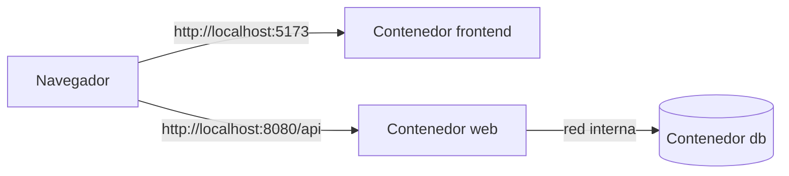

# Despliegue y entorno

El proyecto se ejecuta con Docker Compose. Hay tres servicios: la interfaz React, la API Laravel y la base de datos MySQL. Los puertos se publican solo en `127.0.0.1` para que no queden expuestos a la red local.

## 1. Servicios

| Servicio | Imagen/base | Puerto | Función |
|---|---|---|---|
| `frontend` | Node 24 Alpine | `127.0.0.1:5173:5173` | Servidor de desarrollo de Vite |
| `web` | PHP 8.4 Apache | `127.0.0.1:8080:80` | API Laravel |
| `db` | MySQL 8.4 | Sin puerto publicado | Base de datos |



El navegador habla directamente con la API. Por eso la URL pública de la API es `http://localhost:8080/api`, no el nombre interno `web`.

## 2. Volúmenes

- `./backend:/var/www/html`: el código PHP se edita en el anfitrión y se ve dentro del contenedor.
- `./frontend:/app`: el código React se edita en el anfitrión.
- `frontend_node_modules:/app/node_modules`: evita mezclar las dependencias del anfitrión con las del contenedor.
- `mysql_data:/var/lib/mysql`: conserva la base de datos al parar los contenedores.

## 3. Variables de entorno

### 3.1. Raíz `.env`

Se copia de `.env.example`:

```env
MYSQL_DATABASE=sabitech_db
MYSQL_USER=sabitech_user
MYSQL_PASSWORD=cambiar_esta_contrasena
MYSQL_ROOT_PASSWORD=cambiar_esta_contrasena_root
```

### 3.2. `backend/.env`

El ejemplo de Laravel trae SQLite por defecto. Para Docker hay que usar MySQL y el host `db`:

```env
APP_NAME=SABITECH
APP_ENV=local
APP_DEBUG=true
APP_URL=http://localhost:8080
APP_LOCALE=es
APP_FALLBACK_LOCALE=es

DB_CONNECTION=mysql
DB_HOST=db
DB_PORT=3306
DB_DATABASE=sabitech_db
DB_USERNAME=sabitech_user
DB_PASSWORD=cambiar_esta_contrasena
```

`DB_DATABASE`, `DB_USERNAME` y `DB_PASSWORD` deben coincidir con los del `.env` de la raíz.

### 3.3. Frontend

`VITE_API_URL` es opcional. Si no se define, el código usa `http://localhost:8080/api`, que es lo correcto para el entorno local.

## 4. Puesta en marcha desde cero

```bash
git clone https://github.com/AlejandroCDO/Sabitech.git
cd Sabitech

cp .env.example .env
cp backend/.env.example backend/.env
```

En Windows PowerShell:

```powershell
Copy-Item .env.example .env
Copy-Item backend/.env.example backend/.env
```

Después de configurar los dos `.env`:

```bash
docker compose up -d --build
docker compose exec web composer install
docker compose exec web php artisan key:generate
docker compose exec web php artisan migrate --seed
```

Comprobaciones:

- Frontend: <http://localhost:5173>
- API: <http://localhost:8080/api/charlas>
- Salud: <http://localhost:8080/up>

Si MySQL todavía no está listo, hay que esperar unos segundos y repetir `migrate --seed`. Es un problema habitual al arrancar los tres servicios a la vez.

## 5. Comandos habituales

| Objetivo | Comando |
|---|---|
| Arrancar | `docker compose up -d` |
| Reconstruir | `docker compose up -d --build` |
| Ver estado | `docker compose ps` |
| Ver logs del backend | `docker compose logs -f web` |
| Ver logs del frontend | `docker compose logs -f frontend` |
| Instalar dependencias PHP | `docker compose exec web composer install` |
| Instalar dependencias JS | `docker compose exec frontend npm install` |
| Ejecutar migraciones | `docker compose exec web php artisan migrate` |
| Reiniciar datos de prueba | `docker compose exec web php artisan migrate:fresh --seed` |
| Parar sin borrar datos | `docker compose down` |
| Parar y borrar la base de datos | `docker compose down -v` |

## 6. Copia de seguridad y restauración

Copia:

```bash
docker compose exec db sh -c 'mysqldump -u root -p"$MYSQL_ROOT_PASSWORD" "$MYSQL_DATABASE"' > copia.sql
```

Restauración:

```bash
docker compose exec -T db sh -c 'mysql -u root -p"$MYSQL_ROOT_PASSWORD" "$MYSQL_DATABASE"' < copia.sql
```

La copia incluye datos, pero no los ficheros subidos ni las variables de entorno. En este prototipo las imágenes se guardan como URL, así que no hay carpeta de subidas que copiar.

## 7. Entorno de demostración

Para una demostración estable:

1. Ejecutar `docker compose up -d --build`.
2. Ejecutar `php artisan migrate:fresh --seed`.
3. Comprobar que `asistente1@sabitech.test` puede iniciar sesión.
4. Probar una reserva y una cancelación.
5. Dejar preparado un usuario con una reserva para enseñar “Mis reservas”.
6. No usar `docker compose down -v` durante la presentación.

Mejoras pendientes para un entorno real:

- Compilar el frontend con `npm run build` y servirlo con un servidor estático.
- Poner `APP_DEBUG=false` y `APP_ENV=production`.
- Usar HTTPS.
- Añadir Mailpit para probar el correo.
- Configurar copias automáticas.
- Añadir integración continua en GitHub Actions.

## 8. Problemas frecuentes

| Problema | Causa probable | Solución |
|---|---|---|
| `SQLSTATE[HY000] [2002]` | MySQL aún no está listo o el host no es `db` | Esperar y revisar `DB_HOST=db` |
| `Class "PDO" not found` | Falta la extensión `pdo_mysql` | Reconstruir la imagen `web` |
| El frontend no carga datos | `VITE_API_URL` incorrecta o API parada | Revisar la URL y `docker compose ps` |
| `419` o errores de sesión | Se está usando sesión de Laravel en vez de token | Enviar `Authorization: Bearer` |
| `npm` no encuentra módulos | Volumen `frontend_node_modules` corrupto | Borrar el volumen y reconstruir |
| La base de datos no tiene datos | No se ejecutó el seeder | `php artisan migrate:fresh --seed` |

## 9. Enlaces relacionados

- [README principal](../../README.md)
- [Arquitectura](Arquitectura.md)
- [Backend](Backend.md)
- [Frontend](Frontend.md)
- [Entrega del checkpoint](Entrega_Checkpoint.md)
