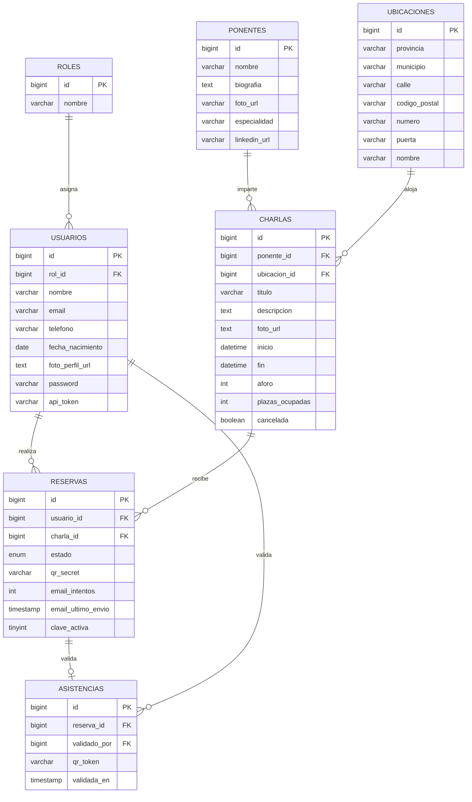

# Modelo de datos

La base de datos es MySQL 8.4, con tablas InnoDB y codificación `utf8mb4`. El objetivo del modelo es que una persona pueda registrarse, reservar una plaza y cancelarla sin que se dupliquen reservas activas ni se supere el aforo.

## 1. Diagrama entidad-relación

## 2. Tablas principales

### 2.1. `roles`

| Campo | Tipo | Nulo | Clave | Descripción |
|---|---|---|---|---|
| `id` | BIGINT UNSIGNED | No | PK | Identificador del rol |
| `nombre` | VARCHAR(50) | No | UNIQUE | `asistente`, `organizador` o `admin` |

### 2.2. `usuarios`

| Campo | Tipo | Nulo | Clave | Descripción |
|---|---|---|---|---|
| `id` | BIGINT UNSIGNED | No | PK | Identificador del usuario |
| `rol_id` | BIGINT UNSIGNED | No | FK → `roles.id` | Rol que determina los permisos |
| `nombre` | VARCHAR(100) | No | | Nombre visible |
| `email` | VARCHAR(150) | No | UNIQUE | Correo de acceso; no se repite |
| `telefono` | VARCHAR(15) | No | | Teléfono de contacto |
| `fecha_nacimiento` | DATE | No | | Se usa para comprobar que la persona es mayor de 16 años |
| `foto_perfil_url` | TEXT | Sí | | URL o ruta de la foto de perfil |
| `password` | VARCHAR(255) | No | | Contraseña cifrada con `bcrypt` |
| `api_token` | VARCHAR(64) | Sí | UNIQUE | Token de sesión; se guarda hasheado en la práctica |
| `created_at` | TIMESTAMP | No | | Fecha de alta |
| `updated_at` | TIMESTAMP | No | | Última modificación |

> Laravel crea también la tabla `users` por defecto. **No se usa en la aplicación**: la tabla real de personas es `usuarios`. Se mantiene porque forma parte de la instalación base de Laravel.

### 2.3. `ponentes`

| Campo | Tipo | Nulo | Descripción |
|---|---|---|---|
| `id` | BIGINT UNSIGNED | No | PK |
| `nombre` | VARCHAR(100) | No | Nombre del ponente |
| `biografia` | TEXT | Sí | Reseña breve |
| `foto_url` | VARCHAR(255) | Sí | Foto del ponente |
| `especialidad` | VARCHAR(100) | Sí | Tema principal |
| `linkedin_url` | VARCHAR(255) | Sí | Perfil profesional |

### 2.4. `ubicaciones`

| Campo | Tipo | Nulo | Descripción |
|---|---|---|---|
| `id` | BIGINT UNSIGNED | No | PK |
| `provincia` | VARCHAR(100) | No | Provincia |
| `municipio` | VARCHAR(100) | No | Municipio |
| `calle` | VARCHAR(100) | No | Calle |
| `codigo_postal` | VARCHAR(10) | No | Código postal |
| `numero` | VARCHAR(10) | No | Número |
| `puerta` | VARCHAR(10) | Sí | Puerta o planta |
| `nombre` | VARCHAR(50) | No | Nombre del espacio |

### 2.5. `charlas`

| Campo | Tipo | Nulo | Descripción |
|---|---|---|---|
| `id` | BIGINT UNSIGNED | No | PK |
| `ponente_id` | BIGINT UNSIGNED | No | FK → `ponentes.id` |
| `ubicacion_id` | BIGINT UNSIGNED | No | FK → `ubicaciones.id` |
| `titulo` | VARCHAR(100) | No | Título de la charla |
| `descripcion` | TEXT | No | Descripción para el detalle |
| `foto_url` | TEXT | Sí | Imagen de la charla |
| `inicio` | DATETIME | No | Fecha y hora de inicio |
| `fin` | DATETIME | No | Fecha y hora de fin; debe ser posterior a `inicio` |
| `aforo` | INT | No | Plazas máximas; debe ser mayor que 0 |
| `plazas_ocupadas` | INT | No | Contador de plazas ocupadas; entre 0 y el aforo |
| `cancelada` | BOOLEAN | No | Indica si la charla se ha cancelado |

Restricciones `CHECK` en MySQL/MariaDB:

- `fin > inicio`.
- `aforo > 0`.
- `plazas_ocupadas >= 0` y `plazas_ocupadas <= aforo`.

### 2.6. `reservas`

| Campo | Tipo | Nulo | Descripción |
|---|---|---|---|
| `id` | BIGINT UNSIGNED | No | PK |
| `usuario_id` | BIGINT UNSIGNED | No | FK → `usuarios.id` |
| `charla_id` | BIGINT UNSIGNED | No | FK → `charlas.id` |
| `estado` | ENUM | No | `pendiente`, `confirmada` o `cancelada` |
| `qr_secret` | VARCHAR(64) | No | Secreto único para generar el QR |
| `email_intentos` | INT | No | Intentos de envío del correo; nunca negativo |
| `email_ultimo_envio` | TIMESTAMP | Sí | Último envío del correo |
| `clave_activa` | TINYINT | Sí | Columna generada: `1` si está pendiente/confirmada; `NULL` si está cancelada |

La clave única `uq_reservas_usuario_charla_activa` se forma con `usuario_id`, `charla_id` y `clave_activa`. Así una persona solo puede tener **una reserva activa** por charla, pero puede volver a reservar si la anterior fue cancelada.

### 2.7. `asistencias`

| Campo | Tipo | Nulo | Descripción |
|---|---|---|---|
| `id` | BIGINT UNSIGNED | No | PK |
| `reserva_id` | BIGINT UNSIGNED | No | FK → `reservas.id`; UNIQUE |
| `validado_por` | BIGINT UNSIGNED | No | FK → `usuarios.id`; quién valida |
| `qr_token` | VARCHAR(128) | Sí | Token leído en el acceso; UNIQUE |
| `validada_en` | TIMESTAMP | No | Momento de la validación |

La tabla impide validar dos veces la misma reserva gracias a `uq_asistencias_reserva_id`.

## 3. Relaciones y reglas de integridad

| Relación | Cardinalidad | Regla |
|---|---|---|
| Rol → usuarios | 1:N | Un rol puede tener muchos usuarios; un usuario tiene un rol |
| Usuario → reservas | 1:N | Un usuario puede tener varias reservas, pero solo una activa por charla |
| Charla → reservas | 1:N | Una charla puede recibir muchas reservas |
| Ponente → charlas | 1:N | Un ponente puede impartir varias charlas |
| Ubicación → charlas | 1:N | Una ubicación puede alojar varias charlas |
| Reserva → asistencia | 1:0..1 | Una reserva puede tener como máximo una asistencia |
| Usuario → asistencias | 1:N | Un organizador/admin puede validar muchas asistencias |

- Las claves foráneas usan `RESTRICT` al borrar para no dejar reservas o charlas huérfanas.
- `ON UPDATE CASCADE` mantiene sincronizados los identificadores.
- La reserva se hace dentro de una transacción: se bloquea la charla con `lockForUpdate`, se comprueba el aforo, se crea la reserva y se incrementa `plazas_ocupadas`.
- La cancelación cambia el estado a `cancelada` y resta una plaza, sin borrar el historial.

## 4. Datos de prueba

Los seeders crean:

- 3 roles.
- 25 asistentes, 1 organizador y 1 administrador.
- Varios ponentes y ubicaciones.
- 20 charlas de ejemplo.
- Reservas y asistencias para probar listados y validaciones.

Credenciales principales:

| Perfil | Correo | Contraseña |
|---|---|---|
| Asistente | `asistente1@sabitech.test` | `password` |
| Organizador | `organizador@sabitech.test` | `password` |
| Administrador | `admin@sabitech.test` | `password` |

## 5. Ficheros relacionados

- Migraciones: `backend/database/migrations/`.
- Seeders: `backend/database/seeders/`.
- Script SQL de referencia: `database/sabitech_db.sql`.
- Diagrama gráfico: `docs/Imagenes/Modelo_Datos_Sabitech_Web.png`.
- Reglas de negocio: [Requisitos](Requisitos.md).
- Uso desde la API: [Backend](Backend.md).
