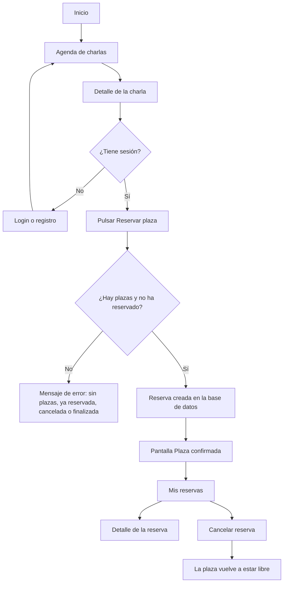

# Recorridos de usuario y pantallas

Este documento describe qué puede hacer cada perfil, qué pantallas utiliza y cómo se comprueba que el recorrido principal funciona. La reserva de una plaza es el centro del checkpoint.

## 1. Perfiles

| Perfil | Puede hacer | No puede hacer todavía |
|---|---|---|
| Visitante | Ver inicio, catálogo, detalle de charlas, registro y login | Reservar sin cuenta, ver reservas ajenas |
| Asistente | Todo lo anterior, reservar, ver sus reservas, cancelar y ver su perfil | Gestionar charlas, validar asistencias |
| Organizador | Consultar usuarios y asistencias mediante la API | Crear charlas desde el frontend |
| Administrador | Consultar usuarios/asistencias y crear charlas mediante la API | Gestión completa desde el frontend |

## 2. Recorrido principal del asistente

## 3. Mapa de pantallas

| Pantalla | Vista/componente | Qué muestra | Acciones principales |
|---|---|---|---|
| Inicio | `MainView` | Presentación de SABITECH y próximas charlas | Ir a la agenda, abrir detalle, reservar |
| Agenda | `CharlasView` | Listado completo, buscador y filtros | Buscar, filtrar, abrir detalle, reservar |
| Detalle de charla | `CharlaDetalleView` | Ponente, descripción, fecha, lugar, aforo | Volver, reservar |
| Plaza confirmada | `PlazaConfirmadaView` | Confirmación de la reserva | Volver a la agenda o ir a mis reservas |
| Login | `LoginView` | Correo, contraseña y “Recordarme” | Iniciar sesión, ir a registro |
| Registro | `RegisterView` | Nombre, correo, teléfono, nacimiento y contraseña | Crear cuenta |
| Mis reservas | `MisReservasView` | Reservas activas y canceladas | Ver detalle, cancelar, explorar charlas |
| Detalle de reserva | `ReservaDetalleView` | Datos de la charla reservada | Volver a mis reservas |
| Perfil | `PerfilView` | Datos de la cuenta y sesión | Volver, cerrar sesión |

La navegación principal no usa una librería de rutas: `App.jsx` guarda la vista actual en estado y actualiza el hash de la URL (`#inicio`, `#charlas`, `#reservas`, `#perfil`, etc.). Es suficiente para el prototipo, aunque en el futuro conviene usar React Router.

## 4. Paso a paso por perfil

### 4.1. Visitante

1. Entra en la página de inicio.
2. Pulsa “Ver agenda” o “Explorar charlas”.
3. Busca por título, ponente, especialidad o ubicación.
4. Filtra por todas, próximas, finalizadas o canceladas.
5. Abre el detalle de una charla.
6. Si pulsa “Reservar plaza”, el sistema le pide iniciar sesión o registrarse.

### 4.2. Registro

1. Desde login, pulsa “Regístrate”.
2. Rellena nombre, correo, teléfono, fecha de nacimiento y contraseña.
3. El navegador comprueba el formato del correo, que el teléfono no esté vacío, que la fecha indique al menos 16 años y que las contraseñas coincidan.
4. El backend vuelve a validar y comprueba que el correo no exista.
5. Si todo es correcto, vuelve al login con un mensaje de éxito.

### 4.3. Asistente: reservar

1. Inicia sesión con su correo y contraseña.
2. Abre la agenda y elige una charla con plazas.
3. Pulsa “Reservar plaza”.
4. El frontend envía `POST /api/reservas` con el token.
5. El backend bloquea la charla, comprueba aforo, fecha y duplicados, crea la reserva y suma una plaza.
6. El frontend muestra “Plaza confirmada” y recarga el catálogo y las reservas.
7. La tarjeta de la charla pasa a mostrar “Plaza reservada”.

### 4.4. Asistente: cancelar

1. Entra en “Mis reservas”.
2. Pulsa “Cancelar reserva” en una reserva futura.
3. Se abre un modal con el título de la charla y la advertencia de que la plaza quedará libre.
4. Confirma la cancelación.
5. El backend cambia el estado a `cancelada` y resta una plaza.
6. La reserva desaparece del listado y se muestra el aviso “Reserva cancelada”.

Solo se puede cancelar si la charla no está cancelada y todavía no ha empezado. El botón “Ver QR” está deshabilitado porque el QR es una funcionalidad posterior.

### 4.5. Organizador y administrador

En esta versión la gestión se hace por API, no por pantallas:

- `GET /api/usuarios`: listado de usuarios.
- `GET /api/asistencias`: listado de asistencias.
- `POST /api/charlas`: creación de charlas, solo administrador.

El área de gestión visual queda para la siguiente entrega.

## 5. Estados que debe mostrar la interfaz

| Situación | Texto o comportamiento |
|---|---|
| Charla cancelada | Estado “Cancelada” y botón deshabilitado |
| Sin plazas | Estado “Plazas agotadas” y botón “Sin plazas” |
| Charla ya empezada | Estado “Finalizada” y botón deshabilitado |
| Reserva ya realizada | Botón “Plaza reservada” |
| Sin sesión | Redirección a login al intentar reservar |
| Token caducado | Se borra la sesión y se vuelve al login |
| Error de red | Mensaje y botón “Reintentar” |
| Lista vacía | Mensaje “No tienes reservas” y enlace a la agenda |

## 6. Responsive y accesibilidad

Comprobaciones aplicadas:

- Diseño adaptable a móvil, tablet y escritorio.
- Botones con texto claro y estados de foco visibles.
- Formularios con `label`, `aria-invalid`, `aria-describedby` y mensajes de error.
- Modal de cancelación con `role="alertdialog"`, foco inicial y cierre con `Escape`.
- Imágenes con texto alternativo y carga diferida en las tarjetas.
- Respeto de `prefers-reduced-motion` para reducir animaciones.
- Contraste revisado en la guía de estilo.

Pendiente:

- Revisión con lector de pantalla real.
- Navegación completa solo con teclado en todas las vistas.
- Texto alternativo definitivo en las imágenes de los seeders.
- Pruebas de zoom al 200 %.

## 7. Enlaces relacionados

- [Requisitos](Requisitos.md)
- [Modelo de datos](Modelo_Datos.md)
- [Frontend](Frontend.md)
- [Guía de estilo](GuiaEstilo.md)
- [Pruebas](Pruebas.md)
